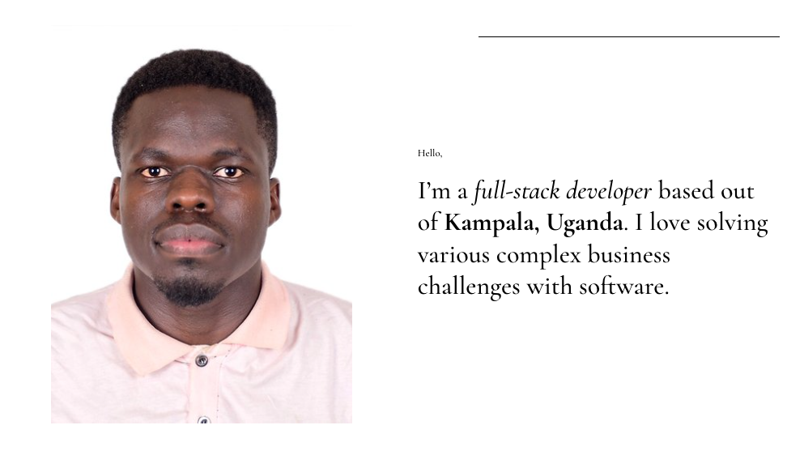

  <h1>Hi, I'm <a href="https://emmanuelnika.com">Emmanuel Nika</a></h1>
  
<strong>Full-stack developer · Kampala, Uganda</strong>

[-341827?style=flat&logo=readdotcv&logoColor=white)](https://emmanuelnika.com/emmanuel-nika-cv.pdf)

I've been shipping production systems since 2019 — Spring Boot and Quarkus
services, Keycloak security and the Angular front ends on top of them. Most
of that work is at [Arxcess](https://arxcess.com), where I own the
authentication layer for the company's Java services.

### Selected work

- **[CarBuddy](https://emmanuelnika.com/work/carbuddy)** — a pre-drive checklist
  and car logbook for Android and iPhone from one Kotlin Multiplatform
  codebase, offline first and synced between phones.
  [Read the case study →](https://emmanuelnika.com/work/carbuddy)
- **[Zineph Salon & Spa](https://zineph.com)** — a fast, search-ready site for a
  Nairobi salon, prerendered on Cloudflare's edge and deployed on every merge.
- **[Quarkus Inventory](https://github.com/EmmanuelNika/quarkus-applications)** —
  a modular-monolith inventory service built two ways, with swappable Keycloak
  or Okta authorization.

More on [emmanuelnika.com](https://emmanuelnika.com/#projects).

### Stack

           

### Get in touch

The quickest way is the form on [emmanuelnika.com](https://emmanuelnika.com/#contact).
